# Try Linux for Mac

Try a Linux desktop on your Mac without repartitioning your drive. Pick a distribution,
and Try Linux downloads the official ARM64 installer, checks it against the
distribution's published SHA-256 checksum, creates a virtual disk and boots it in a
window. It uses Apple's built-in Virtualization framework, so there's nothing else to
install.

This is the Mac edition of [Try Linux for Windows](https://github.com/donnysaengkio/try-linux).
There's also [Try Linux for Linux](https://github.com/donnysaengkio/try-linux-linux) (preview).

> **Preview:** this first version is being tested. Please report problems in
> [Issues](../../issues).

## Distributions

| Distribution | About |
|---|---|
| [Fedora&nbsp;Workstation](https://fedoraproject.org/workstation/) | A community distribution sponsored by Red Hat that ships new GNOME, kernel and Mesa releases soon after they come out |
| [Ubuntu&nbsp;Desktop](https://ubuntu.com/desktop) | The most widely used desktop Linux, made by Canonical, with long-term support releases and a large software catalog |
| [Debian](https://www.debian.org/) | One of the oldest community distributions, known for stability and the base of Ubuntu, Mint and many others |
| [openSUSE&nbsp;Tumbleweed](https://www.opensuse.org/#Tumbleweed) | A rolling-release distribution from the openSUSE community that always has the newest KDE Plasma and kernel |

On **Choose a Linux OS**, each one has a **Website ↗** link to its home page.

Macs with Apple silicon run ARM64 (aarch64) Linux, so only distributions that publish
ARM64 installers are listed. You can also install from any ARM64 `.iso` file or
download link.

## Screenshots

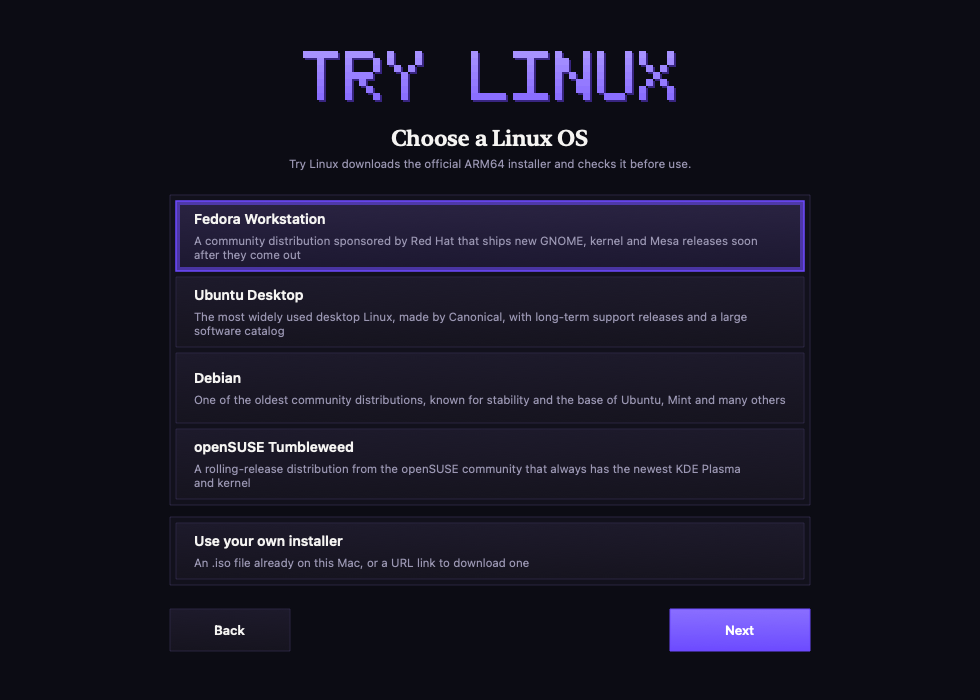

| | |
|---|---|
| 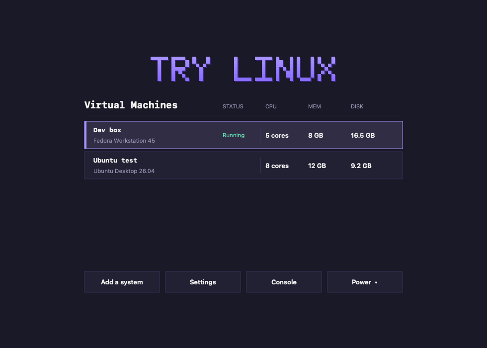 | 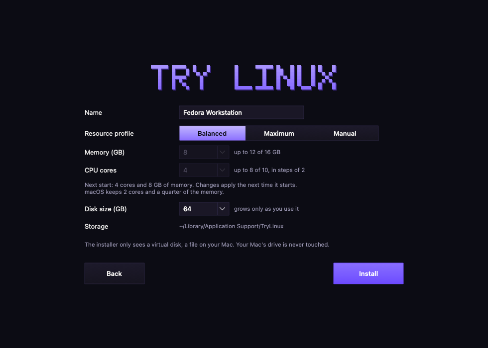 |
| **Virtual Machines:** status, CPU, memory and disk use, console, start or power commands | **Create:** name, description and location, then resources and disk size, then a summary |
| 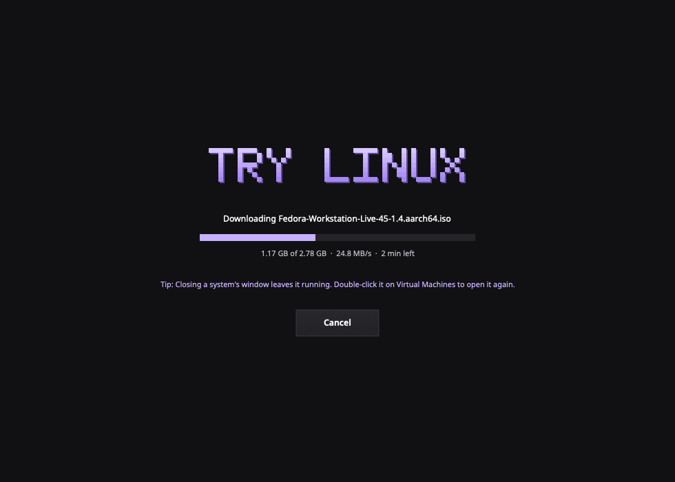 | 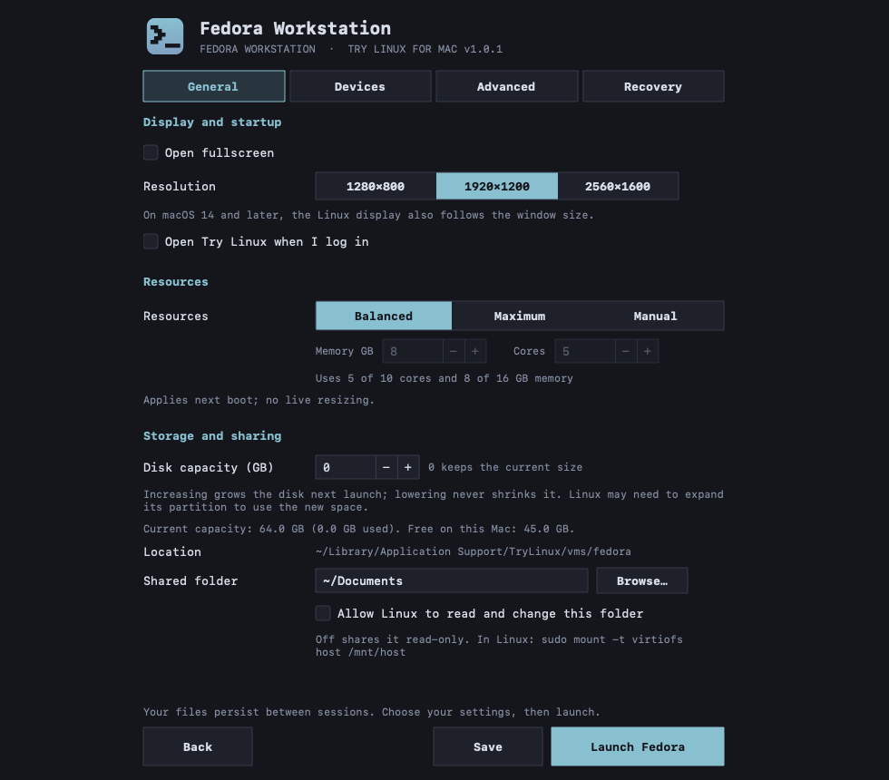 |
| **Download:** the installer is checked against its SHA-256 checksum | **Settings > General:** info and description, display, startup, shared folder, appearance, about and updates |
| 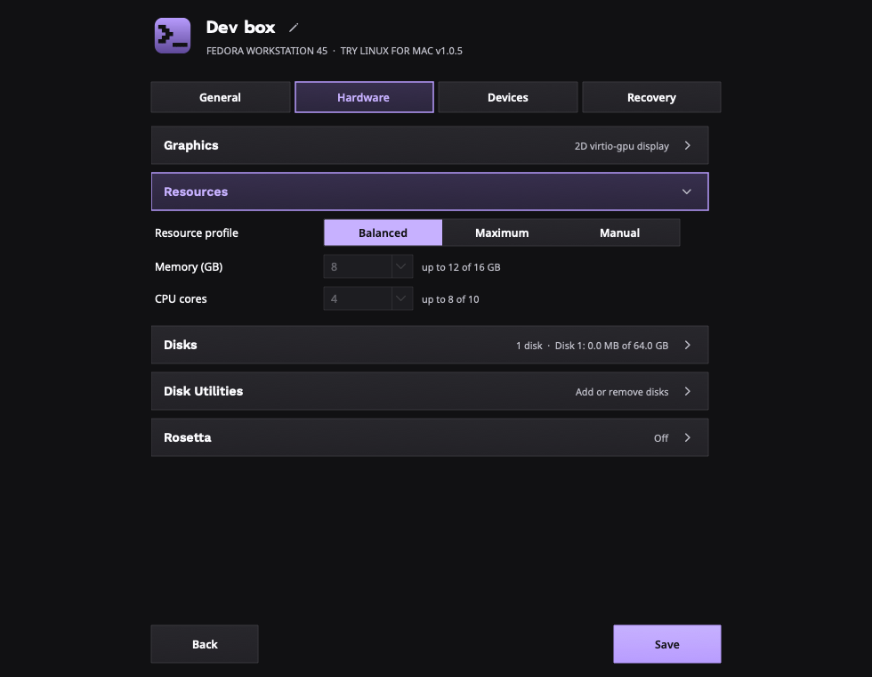 | 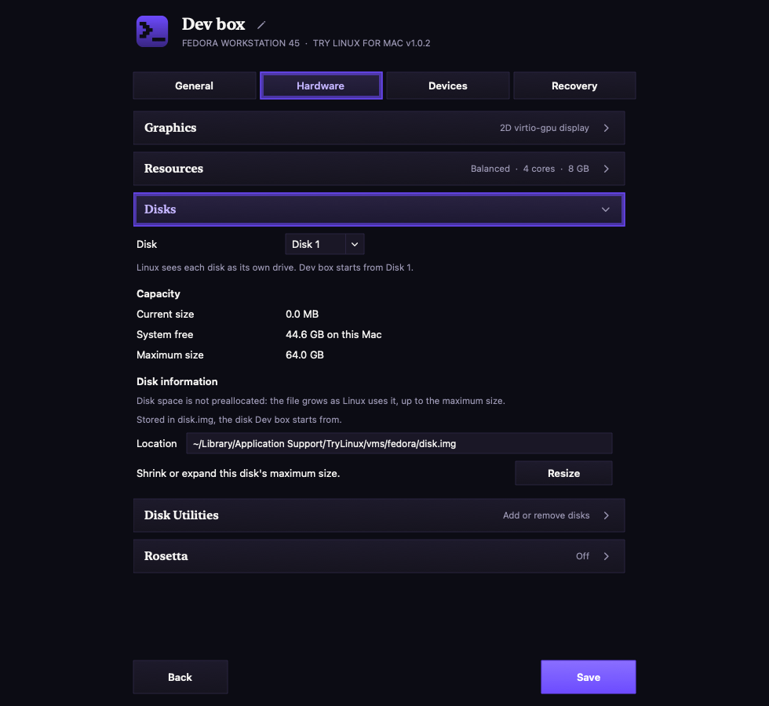 |
| **Settings > Hardware:** graphics, memory and CPU cores, disks, Rosetta | **Disks:** size and location, then Disk Utilities: resize, add and remove disks |
| 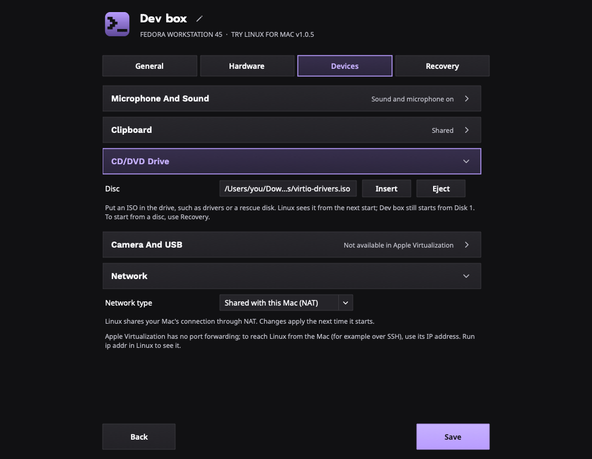 | 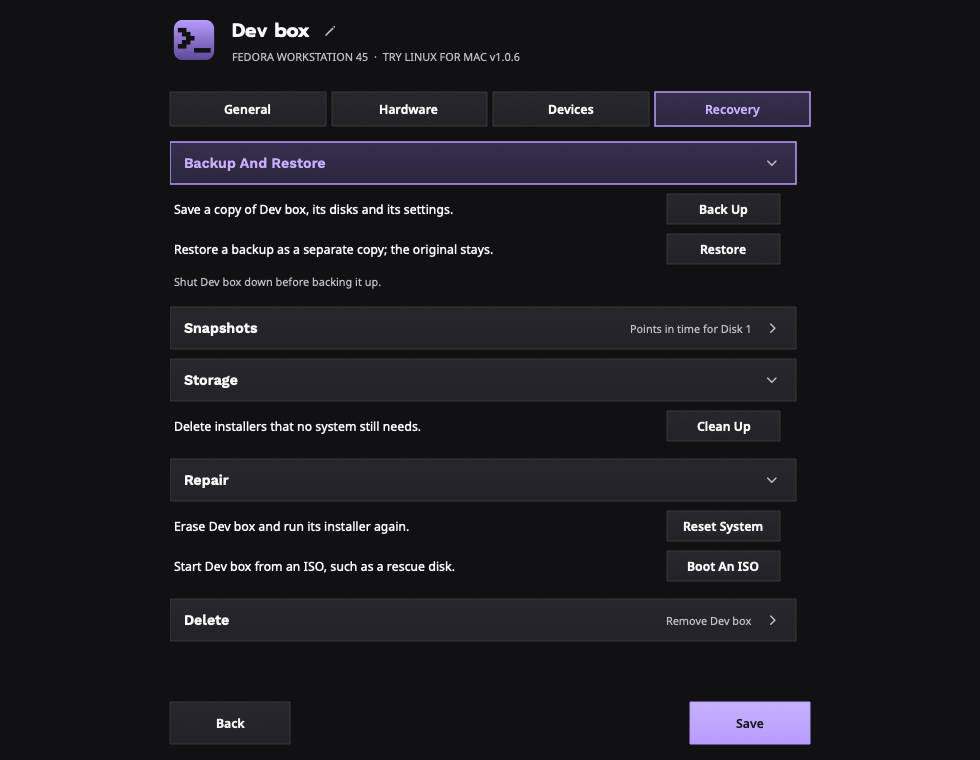 |
| **Settings > Devices:** sound, clipboard, CD/DVD drive, network type | **Settings > Recovery:** backups, snapshots, storage, repair, delete |
| 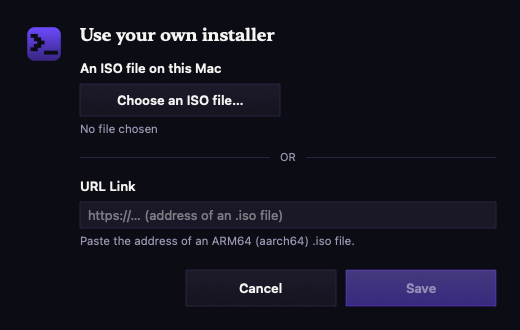 | 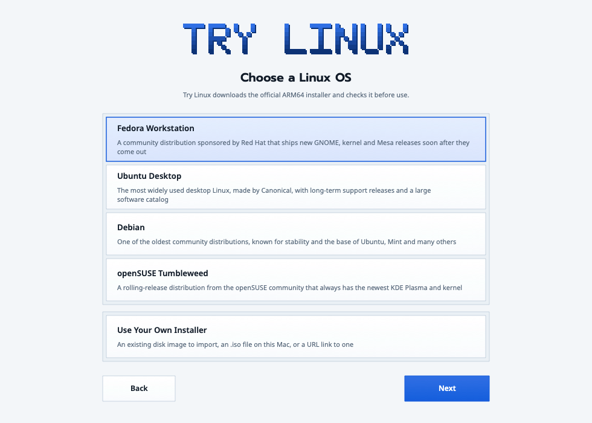 |
| **Use Your Own Installer:** an existing disk image, an ISO file or a link | **Light theme** |
| 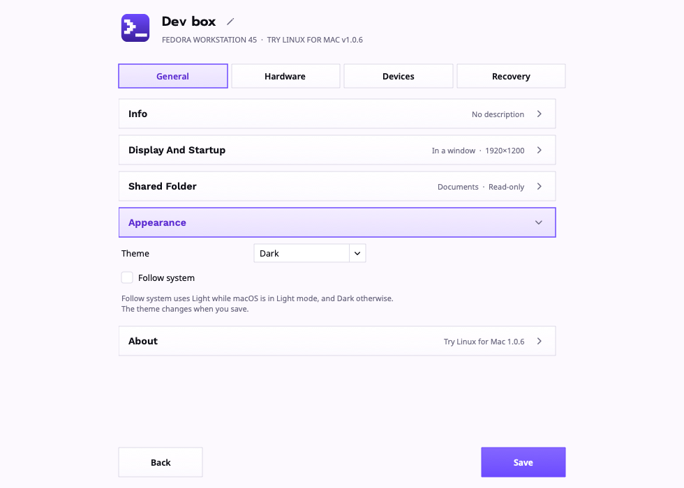 | |
| **Settings > General > Appearance:** Dark or Light, or follow macOS | |

## Requirements

- A Mac with Apple silicon (M1 or later)
- macOS 13 Ventura or later
- About 20 GB of free space per system

## Install

1. Download `TryLinux-<version>-macOS.zip` from [Releases](../../releases) and open it.
2. Open **Try Linux.app**. The app isn't notarized by Apple, so macOS blocks it the
   first time. Open **System Settings > Privacy & Security**, scroll down, click
   **Open Anyway** next to "Try Linux", and confirm.
3. Try Linux asks whether to install itself:

   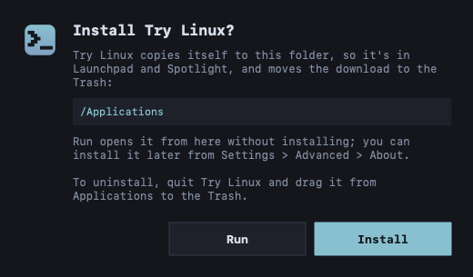

   - **Install** copies Try Linux to your Applications folder, so it's in Launchpad
     and Spotlight, and moves the download to the Trash. **Try Linux is installed**
     confirms it; click **Open** to start the installed copy. If you can't change
     `/Applications`, it uses the Applications folder in your home folder.
   - **Run** opens it from where it is, without installing. It won't ask again for
     this version; you can install later from **Settings > General > About**.
   - Closing the window asks whether to quit, and Try Linux asks again next time.

If a different version is already in Applications, the same prompt offers **Update**
instead, which replaces it.

To check the download against the SHA-256 hash published with each release:

```sh
shasum -a 256 TryLinux-*-macOS.zip
```

## Uninstall

Quit Try Linux (from its menu bar icon, which shuts running systems down), then drag
**Try Linux** from your Applications folder to the Trash. Your systems and downloads
are kept in `~/Library/Application Support/TryLinux`; delete that folder to remove
them too. If you turned on **Open at login**, turn it off first in Settings > General.

## Updates

Once a day, Try Linux checks GitHub for a new release. When there is one, a
notification with an **Update** button appears at the top of the window.

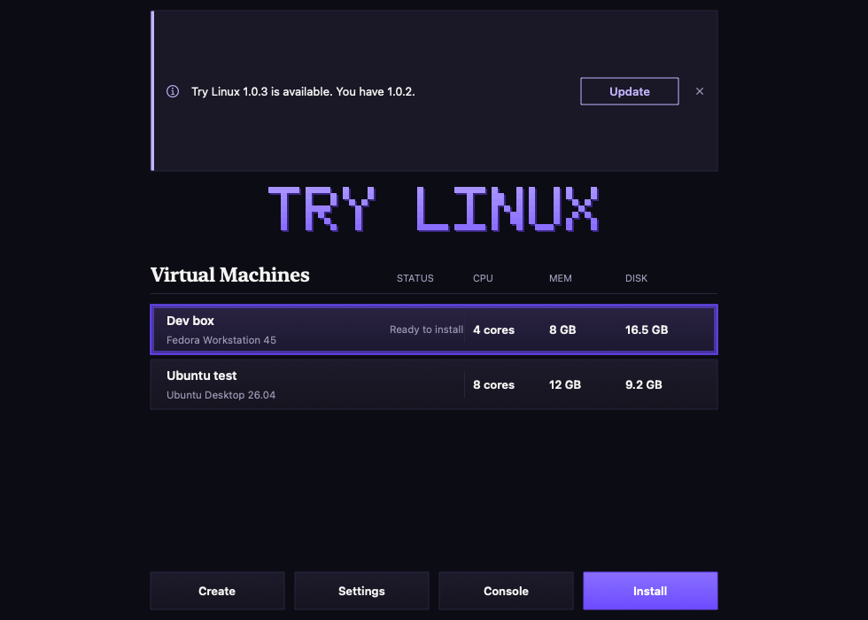

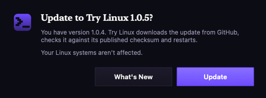

1. **What's New** opens the release notes; **Update** downloads the new version.
2. Try Linux checks the download against the release's published SHA-256 checksum
   and the app's signature. If either doesn't match, the update isn't used.
3. Try Linux replaces itself and restarts. Linux runs inside Try Linux, so if
   systems are running, choose **Update When I Quit**: the update downloads now and
   is installed the next time Try Linux quits.

**Settings > General > About** has **Check For Updates** to check right away, and
**Check for updates automatically (once a day)** to turn the daily check off.

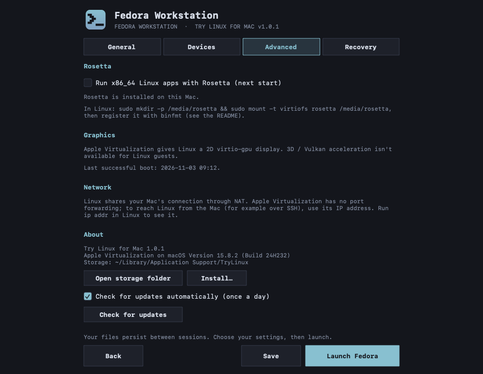

Versions before 1.0.1 don't have the Update button, so download the new version once
by hand.

## Using it

Click **Create** and choose a Linux OS, then:

1. **General:** the system's name, an optional description, and its location (the
   storage folder, or tick **Choose a different location** and choose another).
2. **Resources:** Balanced, Maximum or Manual memory and CPU cores, and the disk size,
   with the free space on that drive. **Allocate the full size now** takes the disk's
   whole size on the drive straight away instead of as Linux stores data.
3. **Summary:** everything you chose. **Install** downloads and verifies the installer,
   creates the virtual disk and opens the system in its own window.

Install Linux onto the virtual disk; your Mac's drive is never touched.

**Use Your Own Installer** comes before General: import an existing raw disk image
(`.img` or `.raw`) that already has Linux on it, pick an ISO file on your Mac, or paste
a URL link to one. An imported disk is copied (an APFS clone, so it's quick), and a
Try Linux system's disk brings its name, description, memory and cores along.


**Virtual Machines** lists each system with its name, the OS and version it was
installed from, and columns for its **Status** (**Running**, **Paused**, **Off, console
open** or **Ready to install**), **CPU**, **memory** and how much **disk** space it takes
now. To rename a system, click the pencil after its name in Settings.


- **Start** (or double-click) starts the selected system.
- **Console** opens a running system's window. On a system that's off, it opens the
  window with the system still off (**Off, console open**); click **Start** to power it
  on there, or close the window. If the system is set to open fullscreen, Console
  asks whether to power it on instead.
- **Closing a system's window** leaves it running, shown as **Running, window
  closed**. Double-click it or click **Console** to bring the window back.
- **Notifications** (updates, results and problems) appear at the top of the window;
  click the X to dismiss one.
- **The Try Linux menu bar icon** lists running systems: open a window, open the
  shared folder, or use the power commands below.
- **Quitting Try Linux** shuts running systems down, so save your work in Linux first.

**Power** replaces **Start** while a system runs:

- **Shut down** presses the power button, so Linux shuts down cleanly. Its desktop
  may ask first; GNOME goes ahead on its own after 60 seconds.
- **Restart** shuts down the same way, then starts the system again with any settings
  you changed.
- **Pause** freezes the system where it is; **Resume** continues.
- **Force stop** turns it off immediately, and **Reset** restarts it immediately. Both
  lose unsaved work.

Each command except Pause and Resume asks you to confirm first:

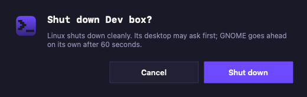 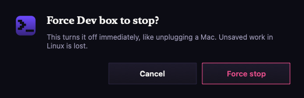

Restarting Linux from inside it turns the system off instead (see
[Limitations](#limitations)); use **Power > Restart** to restart it.

**Several systems can run at once**, each in its own window with its own status and
Power menu. Each one uses the memory its resource profile gives it: two **Balanced**
systems fit, but two **Maximum** ones need more memory than your Mac has.

**Settings** (for each system). Each tab is a list of sections; click one to open it.
Several can be open at once, and the one you opened last is highlighted. A closed
section shows a summary of its settings; every section starts closed when you open
Settings.

- **General:** **Info** (the description, the OS, its home page and where the system is kept),
  fullscreen, resolution, open at login, a shared Mac folder, **Appearance**, and
  **About** with the version, Install and update checks.
- **Appearance** is for Try Linux as a whole: **Dark** (grays with lavender, after
  Firefox's dark theme) or **Light** (white with Proton's purple, after Proton Pass's
  light theme). **Follow system** uses Light while macOS is in Light mode, and Dark
  otherwise. The theme changes when you save.
- **Hardware:**
  - **Graphics:** what Linux's display can do.
  - **Resources:** Balanced, Maximum or Manual (memory and CPU cores can be changed
    with Manual). They only go up to what's free: macOS keeps 2 cores and a quarter of
    the memory, and other running systems keep theirs.
  - **Disks:** each disk's current size, free space on the Mac, maximum size, location
    and whether it's dynamic or preallocated. Under **Disk Utilities**, **Resize** grows
    or shrinks a disk, **Add Disk** creates a new disk or attaches an existing raw
    `.img` file, and **Remove** takes one out. Linux sees each disk as its own drive and
    starts from Disk 1. Backups include every disk.
  - **Rosetta** for x86_64 Linux apps.
- **Devices:** sound and microphone, clipboard sharing, a **CD/DVD drive** for ISOs
  such as drivers or rescue disks (Linux sees it from the next start), and **network
  type** (shared with this Mac, or no network).
- **Recovery:** back up, restore as a copy, snapshots, clean up downloads, repair
  (reset, or boot an ISO) and delete.

Memory, CPU cores and disk sizes are dropdowns of common sizes that you can also type
into.

**Reset**, **Delete**, **Clean up**, and reverting or deleting a snapshot ask first, and
pressing Return picks **Cancel**:

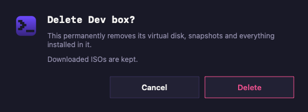 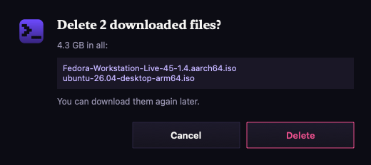

### Shared folder

The folder is read-only unless you allow changes in Settings. To use it in Linux:

```sh
sudo mkdir -p /mnt/host
sudo mount -t virtiofs host /mnt/host
```

### Clipboard

Copy and paste between macOS and Linux needs `spice-vdagent` in Linux. Fedora and Ubuntu
include it; on Debian and openSUSE, install the `spice-vdagent` package.

### Rosetta

With Rosetta turned on in Settings > Hardware, ARM64 Linux can run x86_64 Linux apps.
In Linux:

```sh
sudo mkdir -p /media/rosetta
sudo mount -t virtiofs rosetta /media/rosetta
sudo /usr/sbin/update-binfmts --install rosetta /media/rosetta/rosetta \
  --magic "\x7fELF\x02\x01\x01\x00\x00\x00\x00\x00\x00\x00\x00\x00\x02\x00\x3e\x00" \
  --mask "\xff\xff\xff\xff\xff\xfe\xfe\x00\xff\xff\xff\xff\xff\xff\xff\xff\xfe\xff\xff\xff" \
  --credentials yes --preserve no --fix-binary yes
```

## Limitations

- Graphics are 2D (virtio-gpu); Apple Virtualization has no 3D / Vulkan acceleration
  for Linux.
- No port forwarding. To reach Linux from the Mac (for example over SSH), use its IP
  address; run `ip addr` in Linux to see it.
- No camera or USB passthrough.
- Restarting Linux from inside it turns the system off: Apple Virtualization reports a
  restart the same way as a power-off, so Try Linux can't start it again on its own.
  Use **Power > Restart** instead, or start it again from Virtual Machines.

## Building from source

On a Mac with Apple silicon and Xcode or the Swift toolchain:

```sh
bash scripts/build-app.sh
```

This produces `build/Try Linux.app` and a zip of it. GitHub Actions builds every push
and runs `--self-test`, which checks the download catalog and renders every screen.

## Credits

- Inspired by [Try Omarchy](https://github.com/omacom/try-omarchy).
- Linux distributions are downloaded from their official mirrors and carry their own
  licenses.
- Fonts, bundled in the app under the [SIL Open Font License 1.1](Resources/Fonts/):
  [Prompt](https://github.com/cadsondemak/Prompt) by Cadson Demak,
  [Work Sans](https://github.com/weiweihuanghuang/Work-Sans) by Wei Huang and
  [Noto Sans](https://github.com/notofonts/latin-greek-cyrillic) by the Noto Project Authors.

## License

Try Linux for Mac is released under the [MIT License](LICENSE).
