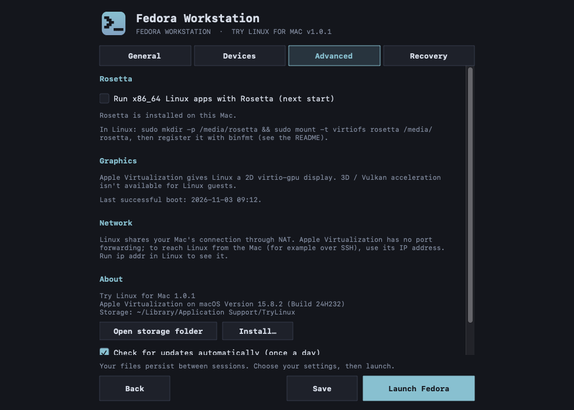

# Try Linux for Mac

Try a Linux desktop on your Mac without repartitioning your drive. Pick a distribution,
and Try Linux downloads the official ARM64 installer, checks it against the
distribution's published SHA-256 checksum, creates a virtual disk and boots it in a
window. It uses Apple's built-in Virtualization framework, so there's nothing else to
install.

This is the Mac edition of [Try Linux for Windows](https://github.com/donnysaengkio/try-linux).

> **Preview:** this first version is being tested. Please report problems in
> [Issues](../../issues).

## Distributions

| Distribution | About |
|---|---|
| [Fedora&nbsp;Workstation](https://fedoraproject.org/workstation/) | A community distribution sponsored by Red Hat that ships new GNOME, kernel and Mesa releases soon after they come out |
| [Ubuntu&nbsp;Desktop](https://ubuntu.com/desktop) | The most widely used desktop Linux, made by Canonical, with long-term support releases and a large software catalog |
| [Debian](https://www.debian.org/) | One of the oldest community distributions, known for stability and the base of Ubuntu, Mint and many others |
| [openSUSE&nbsp;Tumbleweed](https://www.opensuse.org/#Tumbleweed) | A rolling-release distribution from the openSUSE community that always has the newest KDE Plasma and kernel |

Macs with Apple silicon run ARM64 (aarch64) Linux, so only distributions that publish
ARM64 installers are listed. You can also install from any ARM64 `.iso` file or
download link.

## Screenshots


| | |
|---|---|
|  |  |
| **Your systems:** start, install or change a system | **Set up:** name, memory and cores, and disk size |
|  |  |
| **Download:** the installer is checked against its SHA-256 checksum | **Settings > General:** display, resources, disk and a shared folder |
|  |  |
| **Settings > Devices:** sound, microphone and clipboard sharing | **Settings > Advanced:** Rosetta, graphics, network, install and updates |
|  | |
| **Settings > Recovery:** back up, restore, snapshots, reset, boot an ISO, clean up and delete | |

## Requirements

- A Mac with Apple silicon (M1 or later)
- macOS 13 Ventura or later
- About 20 GB of free space per system

## Install

1. Download `TryLinux-<version>-macOS.zip` from [Releases](../../releases) and open it.
2. Open **Try Linux.app**. The app isn't notarized by Apple, so macOS blocks it the
   first time. Open **System Settings > Privacy & Security**, scroll down, click
   **Open Anyway** next to "Try Linux", and confirm.
3. Try Linux asks whether to install itself:

   

   - **Install** copies Try Linux to your Applications folder, so it's in Launchpad
     and Spotlight, and moves the download to the Trash. **Try Linux is installed**
     confirms it; click **Open** to start the installed copy. If you can't change
     `/Applications`, it uses the Applications folder in your home folder.
   - **Run** opens it from where it is, without installing. It won't ask again for
     this version; you can install later from **Settings > Advanced > About**.
   - Closing the window asks whether to quit, and Try Linux asks again next time.

If a different version is already in Applications, the same prompt offers **Update**
instead, which replaces it.

To check the download against the SHA-256 hash published with each release:

```sh
shasum -a 256 TryLinux-*-macOS.zip
```

## Uninstall

Quit Try Linux (from its menu bar icon, which shuts running systems down), then drag
**Try Linux** from your Applications folder to the Trash. Your systems and downloads
are kept in `~/Library/Application Support/TryLinux`; delete that folder to remove
them too. If you turned on **Open at login**, turn it off first in Settings > General.

## Updates

Once a day, Try Linux checks GitHub for a new release. When there is one, an
**Update to x.y.z** button appears on the home screen.


1. **What's new** opens the release notes; **Update** downloads the new version.
2. Try Linux checks the download against the release's published SHA-256 checksum
   and the app's signature. If either doesn't match, the update isn't used.
3. Try Linux replaces itself and restarts. Linux runs inside Try Linux, so if
   systems are running, choose **Update when I quit**: the update downloads now and
   is installed the next time Try Linux quits.

**Settings > Advanced > About** has **Check for updates** to check right away, and
**Check for updates automatically (once a day)** to turn the daily check off.


Versions before 1.0.1 don't have the Update button, so download the new version once
by hand.

## Using it

- **Choose a Linux**, then **Next** and **Install**. Try Linux downloads and verifies the
  installer, creates a virtual disk and opens the system in its own window. Install
  Linux onto the virtual disk; your Mac's drive is never touched.
- Running systems are in the **Try Linux menu bar icon**: show the window, open the
  shared folder, shut down cleanly or force stop.
- Quitting Try Linux shuts running systems down, so save your work in Linux first.

**Settings** (for each system):

- **General:** fullscreen, resolution, open at login, resource profile (Balanced /
  Maximum / Manual), disk capacity and a shared Mac folder.
- **Devices:** sound, microphone and clipboard sharing.
- **Advanced:** Rosetta for x86_64 Linux apps, graphics and network details, and
  **About** with the version, Install and update checks.
- **Recovery:** back up, restore as a copy, snapshots, reset, boot an ISO, clean up
  downloads and delete.

### Shared folder

The folder is read-only unless you allow changes in Settings. To use it in Linux:

```sh
sudo mkdir -p /mnt/host
sudo mount -t virtiofs host /mnt/host
```

### Clipboard

Copy and paste between macOS and Linux needs `spice-vdagent` in Linux. Fedora and Ubuntu
include it; on Debian and openSUSE, install the `spice-vdagent` package.

### Rosetta

With Rosetta turned on in Settings > Advanced, ARM64 Linux can run x86_64 Linux apps.
In Linux:

```sh
sudo mkdir -p /media/rosetta
sudo mount -t virtiofs rosetta /media/rosetta
sudo /usr/sbin/update-binfmts --install rosetta /media/rosetta/rosetta \
  --magic "\x7fELF\x02\x01\x01\x00\x00\x00\x00\x00\x00\x00\x00\x00\x02\x00\x3e\x00" \
  --mask "\xff\xff\xff\xff\xff\xfe\xfe\x00\xff\xff\xff\xff\xff\xff\xff\xff\xfe\xff\xff\xff" \
  --credentials yes --preserve no --fix-binary yes
```

## Limitations

- Graphics are 2D (virtio-gpu); Apple Virtualization has no 3D / Vulkan acceleration
  for Linux.
- No port forwarding. To reach Linux from the Mac (for example over SSH), use its IP
  address; run `ip addr` in Linux to see it.
- No camera or USB passthrough.

## Building from source

On a Mac with Apple silicon and Xcode or the Swift toolchain:

```sh
bash scripts/build-app.sh
```

This produces `build/Try Linux.app` and a zip of it. GitHub Actions builds every push
and runs `--self-test`, which checks the download catalog and renders every screen.

## Credits

- Inspired by [Try Omarchy](https://github.com/omacom/try-omarchy).
- Linux distributions are downloaded from their official mirrors and carry their own
  licenses.

## License

Try Linux for Mac is released under the [MIT License](LICENSE).
